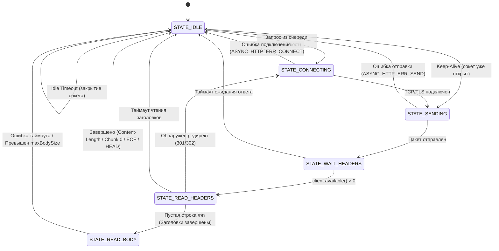

[English](ARCHITECTURE_EN.md) | [Русский](ARCHITECTURE.md)

# Архитектура и спецификация asyncHTTP

Документ описывает внутреннее устройство, архитектуру конечного автомата (FSM), модель управления памятью и сетевой стек библиотеки **asyncHTTP**.

---

## 1. Введение и назначение проекта

**asyncHTTP** — это легковесная, полностью неблокирующая клиентская библиотека HTTP/HTTPS для микроконтроллеров **ESP8266** и **ESP32**, созданная по принципу нулевых внешних зависимостей (Zero-dependency networking).

### Проблема синхронного HTTPClient:
В стандартных библиотеках ядра (`ESP8266HTTPClient` / `HTTPClient`):
- Вызов `http.GET()` или `http.POST()` блокирует поток исполнения на **1–4 секунды** (DNS-резолвинг, 3-way TCP handshake, TLS-рукопожатие BearSSL, ожидание ответа сервера и скачивание пакетов).
- На одноядерном ESP8266 кооперативный цикл `loop()` полностью замирает: прерывается динамическая индикация дисплеев, замирают секунды часов, пропускаются клики кнопок и энкодеров.

### Архитектурное решение asyncHTTP:
- Кооперативный конечный автомат (FSM), где метод `tick()` опрашивает сетевой буфер `client.available()` и выполняется быстрее чем за **1 микросекунду** при отсутствии новых данных.
- Разделение процессов на микро-шаги: подключение, поточное чтение заголовков, поточное декодирование чанков, освобождение кучи.
- Удержание соединения **HTTP Keep-Alive** с автоматическим тайм-аутом простоя (Idle Timeout) для мгновенного выполнения конвейерных запросов.

---

## 2. Архитектура слоев (Layered Architecture)

```
+-------------------------------------------------------------+
|                        User Sketch                          |
|         setup(), loop() [полностью свободен], callback()    |
+-------------------------------------------------------------+
                              │
+-------------------------------------------------------------+
|                          AsyncHTTP                          |
|   - begin() / stop() / tick()                               |
|   - get(), post(), put(), patch(), del(), head(), send()    |
|   - Request FIFO Queue (Очередь запросов)                   |
|   - Keep-Alive Manager & Idle Timeout Auto-Close            |
|   - Redirect Manager (301, 302, 303, 307, 308)              |
|   - FreeRTOS Task Worker (ESP32)                            |
+-------------------------------------------------------------+
                              │
+-------------------------------------------------------------+
|                       AsyncHTTPCore                         |
|   - ParsedUrl (Парсинг схемы, хоста, порта и пути)          |
|   - Chunked Transfer Stream Decoder (Потоковый декодер)     |
|   - Header Parser (Content-Length, Type, Location...)       |
|   - extractField() / jsonUnescape() / xmlUnescape()         |
|   - parseJson() (Интеграция с ArduinoJson 7)                |
+-------------------------------------------------------------+
                              │
+-------------------------------------------------------------+
|                 Системный сетевой уровень                   |
|     ESP32: WiFiClient /       │   ESP8266: WiFiClient /     |
|            WiFiClientSecure   │            BearSSL (TLS)    |
|     (lwIP sockets / mbedTLS)  │   (Лимитированные буферы)   |
+-------------------------------------------------------------+
```

---

## 3. Конечный автомат (FSM: Finite State Machine)

Автомат библиотеки не содержит ни одного блокирующего вызова `delay()` или цикла `while(waiting)`. Переключение состояний происходит строго по событиям готовности сокета:



### Описание состояний:
1. **`STATE_IDLE`**: Клиент свободен. Проверяет очередь исходящих запросов. Если очередь пуста, но сокет удерживается по Keep-Alive — отсчитывает тайм-аут бездействия (`_keepAliveTimeoutSec`). При превышении закрывает сокет и освобождает память.
2. **`STATE_CONNECTING`**: Проверяет схему (`http` или `https`), выбирает соответствующий клиент (`_clientHttp` или `_clientHttps`) и вызывает `connect(host, port)`.
3. **`STATE_SENDING`**: Формирует HTTP/1.1 пакет, отправляет метод, путь, Host, заголовки, тело и переходит в ожидание ответа.
4. **`STATE_WAIT_HEADERS`**: Неблокирующее ожидание первого байта ответа. Если в `tick()` данных нет — мгновенно возвращает управление в `loop()`.
5. **`STATE_READ_HEADERS`**: Построчное чтение заголовков. Парсит код ответа, `Content-Length`, `Transfer-Encoding`, `Location`, `Connection`. При получении `\r\n` заголовки считаются прочитанными. Если метод запроса был `ASYNC_HTTP_HEAD` (RFC 7231/9110), чтение тела не выполняется и запрос сразу переходит к завершению.
6. **`STATE_READ_BODY`**: Приём полезной нагрузки в зависимости от типа передачи:
   - **Chunked Decoder:** пошаговый разбор hex-длин и данных чанков.
   - **Content-Length:** приём точного количества байт блоками до 128 байт.
   - **Connection Close (EOF):** чтение до закрытия сокета сервером.

---

## 4. Потоковый декодер Chunked Transfer Encoding

Большинство современных REST API (например, Open-Meteo) передают динамические JSON-ответы через `Transfer-Encoding: chunked`. Если клиент не умеет разбирать чанки, тело ответа будет замусорено hex-размерами строк и служебными CRLF, что делает парсинг JSON невозможным.

В `asyncHTTP` реализован собственный потоковый субавтомат:
```
           ┌──────────────┐
           │  CHUNK_SIZE  │ <── Чтение hex-размера чанка до \n
           └──────┬───────┘
                  │ (размер > 0)
                  ▼
           ┌──────────────┐
           │  CHUNK_DATA  │ <── Чтение ровно N байт данных в буфер
           └──────┬───────┘
                  │ (все N байт прочитаны)
                  ▼
           ┌──────────────┐
           │  CHUNK_CRLF  │ <── Пропуск завершающего \r\n
           └──────┬───────┘
                  │
                  ▼ (возврат к CHUNK_SIZE для следующего чанка)
                  │
                  ▼ (если размер == 0)
           ┌────────────────┐
           │ CHUNK_TRAILERS │ <── Чтение терминатора \r\n\r\n -> FINISH
           └────────────────┘
```
- Чтение данных производится безопасными порциями до 128 байт за один проход `tick()`.
- Пользователь в callback получает идеально чистую строку JSON/XML без служебных символов протокола передачи.

---

## 5. Управление памятью и защита от сбоев (Heap Safety)

На микроконтроллерах с объёмом RAM 80 КБ (ESP8266) неконтролируемое выделение памяти приводит к панике ядра (OOM Crash).

### Меры защиты в `asyncHTTP`:
1. **Буферы BearSSL (ESP8266):**  
   По умолчанию для HTTPS задаются лимитированные размеры буферов:
   ```cpp
   _clientHttps.setBufferSizes(2048, 512); // RX = 2 КБ, TX = 512 байт
   ```
   Это оставляет более **50 КБ свободной оперативной памяти**, предотвращая фрагментацию кучи.
2. **Лимит тела ответа (`maxBodySize`):**  
   По умолчанию максимальный размер принимаемого тела ограничен **16 КБ** (`setMaxBodySize(16384)`). Если сервер попытается отдать мегабайтный файл, клиент остановит загрузку с кодом ошибки `ASYNC_HTTP_ERR_TOO_LARGE` и не позволит исчерпать кучу.
3. **Предвыделение памяти (`reserve`):**  
   Если сервер передаёт заголовок `Content-Length`, буфер строки делает одиночную аллокацию `body.reserve(len + 1)`, исключая многократные реаллокации памяти.

---

## 6. Механизм HTTP Keep-Alive и Idle Timeout

В стандартных реализациях каждое обращение к серверу выполняет новый цикл:  
`DNS Lookup` (50–300 мс) + `TCP Handshake` (30–100 мс) + `TLS Handshake` (300–800 мс).

### Логика работы Keep-Alive в `asyncHTTP`:
1. При отправке запроса передаётся заголовок `Connection: keep-alive`.
2. После успешного скачивания ответа сокет **не закрывается**, а фиксируется время завершения:
   ```cpp
   _idleStartTime = millis();
   ```
3. Если следующий запрос из очереди направлен к тому же хосту и порту:
   - Сокет используется повторно.
   - Запрос уходит в сеть мгновенно (за **15–30 мс**).
   - После завершения второго запроса отметка `_idleStartTime` обновляется заново.
4. Если запросов нет в течение `_keepAliveTimeoutSec` (по умолчанию 10 секунд):
   - Автомат в состоянии `STATE_IDLE` закрывает соединение (`client.stop()`).
   - Контекст TLS освобождается, возвращая память в кучу.
5. Если поступил запрос к другому домену — предыдущий сокет немедленно закрывается, уступая место новому хосту.

---

## 7. Модель многозадачности (FreeRTOS vs Cooperative)

- **На ESP8266:**  
  Используется кооперативная модель. Вызов `httpClient.tick()` помещается в `loop()`. За счёт микросекундного времени выполнения он не оказывает никакого влияния на работу интерфейса, бегущих строк и часов.
- **На ESP32:**  
  Поддерживаются оба режима:
  1. Кооперативный: вызов `httpClient.tick()` в `loop()`.
  2. Фоновый воркер FreeRTOS: при создании `AsyncHTTP httpClient(true);` библиотека автоматически создаёт задачу на Core 1 с настраиваемым приоритетом и размером стека (`xTaskCreatePinnedToCore`). В этом случае очередь и автомат работают полностью независимо в фоне.
