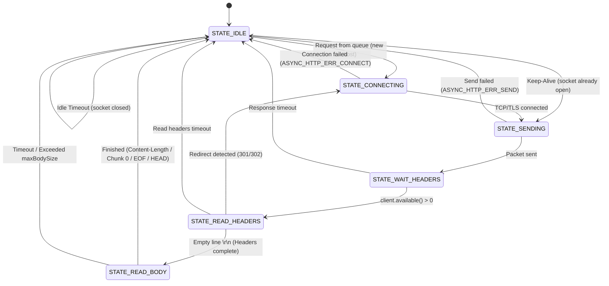

[English](ARCHITECTURE_EN.md) | [Русский](ARCHITECTURE.md)

# asyncHTTP Architecture and Specification

This document details the internal design, Finite State Machine (FSM) architecture, memory management model, and networking stack of the **asyncHTTP** library.

---

## 1. Introduction and Motivation

**asyncHTTP** is a lightweight, non-blocking asynchronous HTTP/HTTPS client library for **ESP8266** and **ESP32** microcontrollers, built around the principle of zero external dependencies.

### The Problem with Synchronous `HTTPClient`:
In standard core libraries (`ESP8266HTTPClient` / `HTTPClient`):
- Calling `http.GET()` or `http.POST()` blocks the execution thread for **1–4 seconds** (DNS resolution, 3-way TCP handshake, TLS handshake, waiting for the server response, and payload downloading).
- On the single-core ESP8266, the cooperative `loop()` completely halts: LED matrix dynamic indication freezes, clock seconds stutter, and button/rotary encoder presses are dropped.

### The asyncHTTP Architectural Solution:
- A cooperative Finite State Machine (FSM) where `httpClient.tick()` inspects the socket buffer (`client.available()`) and executes in **less than 1 microsecond** when no new data is present.
- Process decomposition into atomic micro-steps: connection, streaming header reading, streaming chunk decoding, and dynamic heap release.
- **HTTP Keep-Alive** connection caching with an automatic idle timeout for near-instant execution of pipelined requests.

---

## 2. Layered Architecture

```
+-------------------------------------------------------------+
|                        User Sketch                          |
|         setup(), loop() [fully unblocked], callback()       |
+-------------------------------------------------------------+
                              │
+-------------------------------------------------------------+
|                          AsyncHTTP                          |
|   - begin() / stop() / tick()                               |
|   - get(), post(), put(), patch(), del(), head(), send()    |
|   - Request FIFO Queue                                      |
|   - Keep-Alive Manager & Idle Timeout Auto-Close            |
|   - Redirect Manager (301, 302, 303, 307, 308)              |
|   - FreeRTOS Task Worker (ESP32)                            |
+-------------------------------------------------------------+
                              │
+-------------------------------------------------------------+
|                       AsyncHTTPCore                         |
|   - ParsedUrl (Scheme, host, port, and path parsing)        |
|   - Chunked Transfer Stream Decoder                         |
|   - Header Parser (Content-Length, Type, Location...)       |
|   - extractField() / jsonUnescape() / xmlUnescape()         |
|   - parseJson() (ArduinoJson 7 integration)                 |
+-------------------------------------------------------------+
                              │
+-------------------------------------------------------------+
|                   System Networking Layer                   |
|     ESP32: WiFiClient /       │   ESP8266: WiFiClient /     |
|            WiFiClientSecure   │            BearSSL (TLS)    |
|     (lwIP sockets / mbedTLS)  │   (Limited size buffers)    |
+-------------------------------------------------------------+
```

---

## 3. Finite State Machine (FSM)

The library's state machine contains no blocking `delay()` calls or `while(waiting)` loops. State transitions are event-driven based on socket readiness:



### State Descriptions:
1. **`STATE_IDLE`**: Client is idle. Checks the outbound FIFO queue. If the queue is empty but a connection is held open via Keep-Alive, counts down the idle timeout (`_keepAliveTimeoutSec`). If the timer expires, gracefully closes the socket and frees memory.
2. **`STATE_CONNECTING`**: Inspects the scheme (`http` or `https`), selects the corresponding client (`_clientHttp` or `_clientHttps`), and initiates `connect(host, port)`.
3. **`STATE_SENDING`**: Assembles the HTTP/1.1 request wire packet (method, path, Host header, custom headers, payload) and transmits it to the server.
4. **`STATE_WAIT_HEADERS`**: Non-blocking wait for the first incoming response byte. If `client.available() == 0`, immediately yields control back to `loop()`.
5. **`STATE_READ_HEADERS`**: Line-by-line header parsing. Extracts HTTP status code, `Content-Length`, `Transfer-Encoding`, `Location`, and `Connection`. Upon reaching the blank line delimiter (`\r\n`), headers are finalized. If the request was `ASYNC_HTTP_HEAD` (RFC 7231/9110), body reading is skipped and the request finishes immediately.
6. **`STATE_READ_BODY`**: Streaming body acquisition according to the transfer mode:
   - **Chunked Decoder:** Iterative hex length parsing and chunk slice ingestion.
   - **Content-Length:** Reads exact payload byte counts in slices up to 128 bytes.
   - **Connection Close (EOF):** Reads data until the socket is closed by the server.

---

## 4. Streaming Chunked Transfer Decoder

Modern REST APIs (such as Open-Meteo) transfer dynamic JSON payloads using `Transfer-Encoding: chunked`. Without chunked decoding, the response body contains raw hex length indicators and protocol delimiters, corrupting JSON documents.

`asyncHTTP` embeds a streaming chunk parser:
```
           ┌──────────────┐
           │  CHUNK_SIZE  │ <── Reads chunk hex size until \n
           └──────┬───────┘
                  │ (size > 0)
                  ▼
           ┌──────────────┐
           │  CHUNK_DATA  │ <── Reads exactly N bytes into buffer
           └──────┬───────┘
                  │ (all N bytes consumed)
                  ▼
           ┌──────────────┐
           │  CHUNK_CRLF  │ <── Skips terminating \r\n
           └──────┬───────┘
                  │
                  ▼ (loops back to CHUNK_SIZE for next chunk)
                  │
                  ▼ (if size == 0)
           ┌────────────────┐
           │ CHUNK_TRAILERS │ <── Reads terminal \r\n\r\n -> FINISH
           └────────────────┘
```
- Data is processed in safe slices up to 128 bytes per `tick()` invocation.
- User callbacks receive a clean, decoded JSON/XML string with all transport artifacts stripped.

---

## 5. Memory Management & Heap Safety

On microcontrollers with limited RAM (ESP8266 has ~80 KB total), unconstrained memory allocations can lead to kernel panic or heap fragmentation.

### Safety Measures in `asyncHTTP`:
1. **BearSSL Buffer Tuning (ESP8266):**  
   Pre-configured bounded TLS buffer sizes:
   ```cpp
   _clientHttps.setBufferSizes(2048, 512); // RX = 2 KB, TX = 512 bytes
   ```
   Leaves over **50 KB of free heap**, eliminating OOM crashes during TLS handshakes.
2. **Payload Protection (`maxBodySize`):**  
   Body accumulation is capped at **16 KB** by default (`setMaxBodySize(16384)`). If an oversized response arrives, downloading is aborted with `ASYNC_HTTP_ERR_TOO_LARGE` to protect available RAM.
3. **Pre-allocation (`reserve`):**  
   When the server supplies a `Content-Length` header, a single allocation is performed (`body.reserve(len + 1)`), eliminating repetitive reallocations.

---

## 6. HTTP Keep-Alive & Idle Timeout

Traditional implementations perform the entire handshake cycle for every request:  
`DNS Lookup` (50–300 ms) + `TCP Handshake` (30–100 ms) + `TLS Handshake` (300–800 ms).

### Keep-Alive Lifecycle in `asyncHTTP`:
1. Transmits `Connection: keep-alive` in request headers.
2. Upon payload completion, the socket remains **open** and an idle timestamp is recorded:
   ```cpp
   _idleStartTime = millis();
   ```
3. If subsequent queued requests target the same host and port:
   - The active socket is immediately reused.
   - The request is dispatched in **15–30 ms**.
   - `_idleStartTime` resets upon completion.
4. If no requests arrive within `_keepAliveTimeoutSec` (default 10 seconds):
   - The FSM gracefully closes the socket (`client.stop()`).
   - TLS buffers and session context are freed back to the system heap.
5. If a request targets a different domain, the active socket is cleanly closed and replaced.

---

## 7. Concurrency Model (FreeRTOS vs. Cooperative)

- **ESP8266:**  
  Cooperative execution. Calling `httpClient.tick()` inside `loop()` takes under a microsecond per check, causing zero interference with display rendering, matrix scanning, or button inputs.
- **ESP32:**  
  Supports two modes:
  1. Cooperative: `httpClient.tick()` in `loop()`.
  2. FreeRTOS Background Task: Initializing `AsyncHTTP httpClient(true);` spawns a dedicated worker pinned to Core 1 (`xTaskCreatePinnedToCore`), managing networking entirely in the background.
